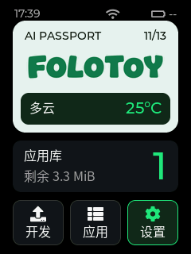
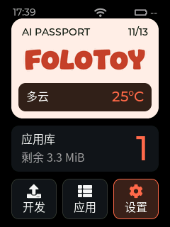
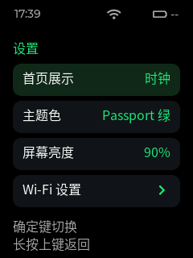
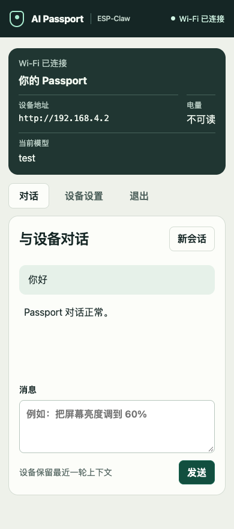

[简体中文](README.md) · **English**

<div align="center">

# Passport Runner

**System firmware for Passport with dynamic native app loading**

Install compatible community apps from your browser, then launch and switch between them on the device.

[Design](#design) · [Quick start](#quick-start) · [Install an app](#install-an-app) · [Project layout](#project-layout)

</div>

Found a community app you want to try? Once Runner is installed, import a compatible firmware bundle from the management page and open the app on your Passport. Your other apps stay in the library. Switching apps needs no USB cable or full firmware reflash. ESP-Claw and Pomodoro use the same installation flow.

- **Passport Runner** is the home screen and app library. See the clock, weather, and available app space on the device. Open apps with the physical buttons, and upload or remove them from your browser.
- **ESP-Claw** brings Espressif’s agent to the Passport’s ESP32-C3. Open the device web page and connect an OpenAI-compatible Chat Completions endpoint that supports tool calls. Try asking it to set the OK button to dim the screen to 35%, then press the button on the Passport.
- **Pomodoro** offers 15, 25, and 45 minute sessions. Press OK to start, pause, or resume. Your remaining time is saved when you return to Runner.

<p align="center">
  
  
  
</p>

Runner’s green home screen, orange home screen, and settings. Captured from the ESP32-C3 emulator. The screenshots show an earlier build before the home screen label changed to Passport Runner.

## Design

### Keep the launcher on the device and start apps on demand

Runner lives in the factory partition and handles Wi-Fi setup, app management, and boot selection. App images live as files in a LittleFS library and use space according to their size. They share one bootable partition, so the library can hold several apps and the device boots one at a time.

When you open an app, Runner writes the selected image into the shared boot partition, sets the next boot target, and restarts. This is how dynamic loading works here. You install apps from the browser and select them on the device, and each one runs as standalone native firmware. The app leaves its OTA state pending verification, so another restart returns to Runner. ESP-Claw and Pomodoro use a long press on UP to return. Community apps keep their own controls, and you can restart the device when needed.

### Turn a community firmware bundle into an installable app

The management page can import a downloaded bundle or fetch one from a supported community link. The browser checks the partition table and image, then extracts the compatible app. Runner checks the uploaded image’s target, size, and integrity before adding it to the library. The import leaves the bundle’s bootloader, partition table, and other contents out of the installation, preserving Runner’s boot entry and installed apps.

Compatibility depends on the image layout, available boot space, and the app’s runtime requirements. Image validation establishes that the app meets the installation requirements. Its behavior still needs to be tested by running it. Native apps have firmware-level access, so install apps you trust. [Import requirements and limits](docs/development/passport-app-manager.md#import-a-community-firmware-download)

## Quick start

Use a **FoloToy AI Passport (ESP32-C3, 8 MB Flash, no PSRAM)** and **ESP-IDF 5.5.3**. Activate ESP-IDF and run the following from the repository root:

```bash
source /path/to/esp-idf-v5.5.3/export.sh
idf.py --version
./tools/validate.sh
```

The full gate runs host tests, builds all three targets, and verifies the images. For build and packaging alone, run `./tools/validate.sh --firmware`. See the [environment setup guide](docs/development/engineering/environment-setup.md) for toolchain installation.

| Artifact | Location | Use |
| --- | --- | --- |
| `FoloToy-AI-Passport-full.bin` | `build/` | Flash at `0x0` to install Runner |
| `Passport-ESP-Claw.bin` | `build/apps/<sha256>/` | Upload through Runner |
| `Passport-Pomodoro.bin` | `build/apps/<sha256>/` | Upload through Runner |

The build prints the exact paths to the two app images. Each app is archived alongside its ELF and MAP. Runner’s debug archive is under `build/firmware/`.

For a fresh installation, connect the Passport with a USB data cable and replace `PORT` with its serial port:

```bash
python -m esptool --chip esp32c3 --port PORT write_flash 0x0 build/FoloToy-AI-Passport-full.bin
```

Flashing the merged image overwrites NVS and the app library. Migrating from the old `manager` and `app_run` layout can preserve settings while clearing the app library. Migrating from the 128 KiB `app_meta` layout can also preserve installed apps. Once the layout matches, a `system`-only update preserves settings and apps. See the [Runner guide](docs/development/passport-app-manager.md#build-and-package).

## Install an app

1. Open **Develop** on the Runner home screen. If the device shows a setup hotspot, join it using the displayed **eight-character connection code** as the Wi-Fi password.
2. Open the address shown on the device and sign in with the same code. Upload the ESP-Claw or Pomodoro `.bin` in **Install App**.
3. Hold UP to return home, open **Apps**, select the app, and press OK. Hold UP inside either bundled app to return to Runner.

The shared app library holds **5,952 KiB (5.81 MiB)**. One app can use the entire library when it is empty. The web page shows the available space. Runner can also import compatible merged images from the community. See the [Runner guide](docs/development/passport-app-manager.md).

To get started with ESP-Claw, open its connection screen and visit the address shown on the Passport. In **Device Settings**, enter the model base URL (typically ending in `/v1`), the model name, and any required API key, then join a 2.4 GHz Wi-Fi network. Once connected, send your first instruction in **Chat**. See the [ESP-Claw guide](docs/development/esp-claw-passport.md).

<p align="center">
  
</p>

ESP-Claw chat in a mobile browser with a test model.

## Project layout

```text
main/
├── runner/          Runner firmware, web UI, partition table, and settings
├── apps/
│   ├── esp-claw/    Agent, model configuration, Lua, and chat page
│   └── pomodoro/    Timer UI and state machine
└── common/          Shared configuration, Wi-Fi, browser pairing, and HTTP
components/bsp/      Passport board drivers
third_party/esp-claw/ Vendored ESP-Claw source
assets/              Shared font and project assets
tools/               Build, verification, packaging, and image extraction
tests/               Host tests
docs/                User and engineering guides
```

Each target has its own `CMakeLists.txt`. The root build selects `manager` (the default), `claw`, or `pomodoro` through `PASSPORT_APP`. To iterate on one target, give it a separate build directory and configuration:

```bash
idf.py -B build/dev-claw -D SDKCONFIG=build/dev-claw/sdkconfig -D PASSPORT_APP=claw build
```

See [LICENSE](LICENSE) for the project license and [NOTICE](third_party/esp-claw/NOTICE) for the upstream ESP-Claw revision and license.
