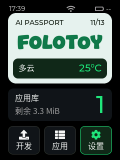
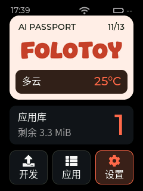
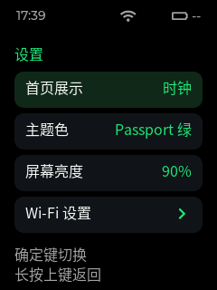
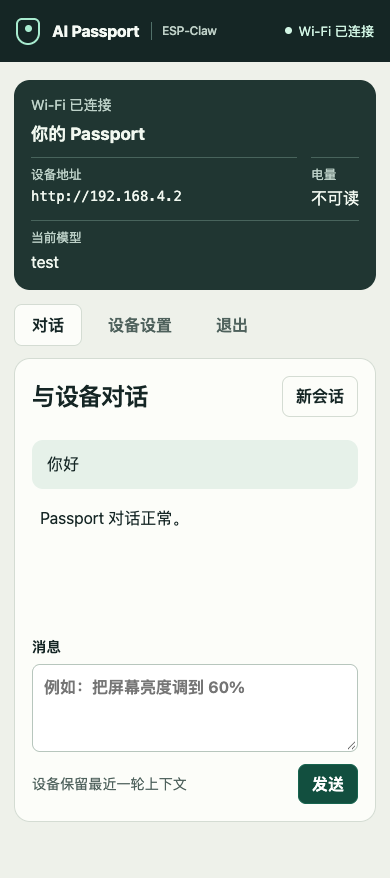

**简体中文** · [English](README.en.md)

<div align="center">

# Passport Runner

**支持动态加载原生应用的 Passport 系统固件**

在浏览器安装兼容的社区应用，在设备上按需启动与切换。

[设计思路](#设计思路) · [快速开始](#快速开始) · [安装应用](#安装应用) · [目录结构](#目录结构)

</div>

看到一个想玩的社区应用？装好 Runner 后，可以直接在管理网页导入兼容的社区固件，再从设备的应用列表打开。已经装好的应用会留在库里，换个玩法无需连接 USB 或重新刷写整包。ESP-Claw 和番茄钟也走同一套安装流程。

- **Passport Runner** 是设备的首页和应用库。首页可以显示时钟、天气和应用剩余空间。用三个实体键打开应用，在浏览器里上传或移除应用。
- **ESP-Claw** 把 Espressif 的 Agent 移植到 Passport 的 ESP32-C3。打开设备网页，接入支持工具调用的 OpenAI 兼容 Chat Completions 服务，就能在浏览器里对话。可以试一句「把确定键绑定为将屏幕亮度设为 35%」，然后回到设备上按键试试。
- **番茄钟** 可以选 15、25 或 45 分钟，确定键开始、暂停和继续。切回 Runner 后，再打开还能接着上次的进度。

<p align="center">
  
  
  
</p>

Runner 的绿色首页、橘色首页和设置页，来自 ESP32-C3 模拟器。截图取自较早构建，首页仍显示 AI PASSPORT。

## 设计思路

### 让首页留在设备上，让应用按需启动

Runner 常驻工厂分区，负责配网、管理应用和选择下一次启动的程序。应用镜像以文件形式存放在 LittleFS 应用库里，按实际大小占用空间。所有应用共用一个可启动分区，因此应用库可以同时存放多个玩法，设备每次启动其中一个。

打开应用时，Runner 将选中的镜像写入共用启动区，设置下一次启动目标，再重启进入应用。这就是这里的「动态加载」：运行哪个应用由用户安装后在设备上选择，应用以独立原生固件运行。应用保持 OTA 待确认状态，再次重启时引导程序回到 Runner。ESP-Claw 和番茄钟都把长按上键作为返回入口。社区应用沿用自己的按键，必要时可以重启设备返回。

### 把社区整包变成可安装应用

管理网页可以导入本地下载的社区整包，也可以从支持的玩法链接下载。浏览器检查分区表和镜像，只提取兼容的应用部分。Runner 再校验上传镜像的目标、大小和完整性，通过后才加入应用库。这样社区包里的引导程序、分区表和其他内容不会随应用一起写入设备，Runner 的启动入口和已装应用可以保留。

兼容性取决于镜像布局、启动区大小和应用所需的运行条件。校验通过只代表镜像符合安装要求，具体玩法仍需运行验证。原生应用拥有设备固件权限，请安装信任的应用。[导入条件和限制](docs/development/passport-app-manager.zh_CN.md#导入社区固件)

## 快速开始

准备一台 **FoloToy AI Passport（ESP32-C3、8 MB Flash、无 PSRAM）**，以及 **ESP-IDF 5.5.3**。在仓库根目录激活工具链并运行：

```bash
source /path/to/esp-idf-v5.5.3/export.sh
idf.py --version
./tools/validate.sh
```

完整流程会运行主机测试、构建三个目标并校验镜像。只需构建和打包时，运行 `./tools/validate.sh --firmware`。工具链安装见[环境搭建指南](docs/development/engineering/environment-setup.zh_CN.md)。

| 产物 | 在哪里找 | 怎么用 |
| --- | --- | --- |
| `FoloToy-AI-Passport-full.bin` | `build/` | 从 `0x0` 刷入设备，安装 Runner |
| `Passport-ESP-Claw.bin` | `build/apps/<sha256>/` | 在 Runner 网页上传 |
| `Passport-Pomodoro.bin` | `build/apps/<sha256>/` | 在 Runner 网页上传 |

构建日志会打印两个应用的完整路径。应用的 ELF 和 MAP 与镜像放在同一目录，Runner 的调试归档位于 `build/firmware/`。

首次安装时，用支持数据传输的 USB 线连接 Passport，把命令里的 `PORT` 换成设备串口：

```bash
python -m esptool --chip esp32c3 --port PORT write_flash 0x0 build/FoloToy-AI-Passport-full.bin
```

整包刷写会覆盖设备的 NVS 和应用库。已经安装 Runner 并想保留 Wi-Fi、浏览器配对和应用时，先核对分区表，再按[固件布局与存储说明](docs/development/engineering/firmware-layout.zh_CN.md#烧录与已存数据)更新管理器分区。

## 安装应用

1. 在 Runner 首页进入 **开发**。如果设备显示配网热点，就加入该热点，用屏幕上的 **8 位连接码**作为 Wi-Fi 密码。
2. 在浏览器打开设备屏幕上的地址，用同一个连接码登录。在 **安装应用** 里上传 ESP-Claw 或番茄钟的 `.bin`。
3. 长按上键回首页，进入 **应用**，选中刚装好的应用，按确定键启动。想回 Runner 时，长按上键。

应用库共用 **4,160 KiB** 存储空间，单个应用上限为 **2,368 KiB**。网页会显示实际余量。想试玩法社区的固件，可以从网页导入符合格式要求的社区整包。详见 [Runner 使用指南](docs/development/passport-app-manager.zh_CN.md)。

第一次用 ESP-Claw 时，在设备上切到连接页，打开屏幕显示的网页。在 **设备设置** 填入模型基地址（通常以 `/v1` 结尾）、模型名和所需的 API 密钥，并将 Passport 接入 2.4 GHz Wi-Fi。联网后在 **对话** 中发送第一条指令。详见 [ESP-Claw 配置和按键说明](docs/development/esp-claw-passport.zh_CN.md)。

<p align="center">
  
</p>

ESP-Claw 的手机浏览器对话界面，截图使用测试模型。

## 目录结构

```text
main/
├── runner/          Runner 固件、管理网页、分区表和专用配置
├── apps/
│   ├── esp-claw/    Agent、模型配置、Lua 和对话网页
│   └── pomodoro/    番茄钟界面和计时状态机
└── common/          公共配置、配网、浏览器配对和 HTTP 处理
components/bsp/      Passport 板级驱动
third_party/esp-claw/ 随仓库分发的 ESP-Claw 上游代码
assets/              共用字库和项目素材
tools/               构建、校验、打包和社区镜像提取
tests/               主机测试
docs/                使用指南和工程文档
```

三个目标各有自己的 `CMakeLists.txt`。根目录通过 `PASSPORT_APP` 选择 `manager`（默认）、`claw` 或 `pomodoro`。单独迭代一个目标时，可以用独立的构建目录和配置：

```bash
idf.py -B build/dev-claw -D SDKCONFIG=build/dev-claw/sdkconfig -D PASSPORT_APP=claw build
```

项目许可见 [LICENSE](LICENSE)。ESP-Claw 的上游版本和许可见 [NOTICE](third_party/esp-claw/NOTICE)。
